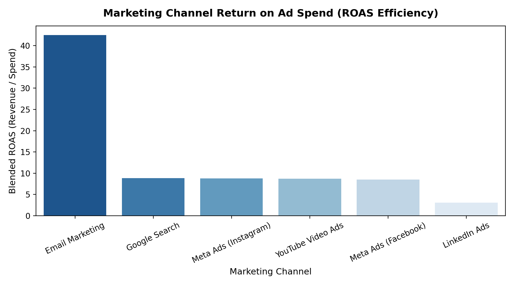
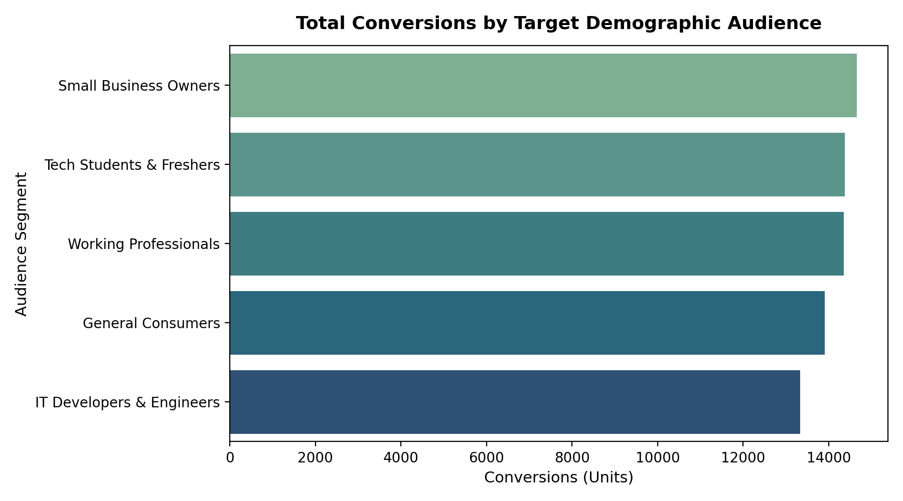

# 📈 Digital Marketing Campaign Analytics & Funnel ROI

[](https://www.python.org/)
[](https://dev.mysql.com/)
[](https://powerbi.microsoft.com/)
[](notebooks/marketing_campaign_roi_analysis.ipynb)
[](https://github.com/123anildalai)

An end-to-end B.Tech data analytics major project evaluating multi-channel advertising performance across 4,000+ campaign runs. Covers full-funnel KPI metrics including CTR, CPC, Conversion Rate, Customer Acquisition Cost (CAC), and Return on Ad Spend (ROAS).

---

## 📊 Analytics Visualizations & Findings

| Marketing Channel ROAS Efficiency | Audience Segment Conversions |
| :---: | :---: |
|  |  |

---

## 📌 Executive Summary & Marketing Insights

1. **Top ROAS Channels**: **Google Search (8.88x ROAS)** and **Meta Ads (8.65x blended ROAS)** deliver the highest profitability and scale, while **Email Marketing** achieved unmatched retention efficiency (>40x ROAS with lowest CPA).
2. **High-Value B2B vs. Volume**: While **LinkedIn Ads** generated lower top-line ROAS (3.06x) due to higher baseline CPC (₹35–75), it achieved the highest conversion intent among Enterprise & Developer audiences.
3. **Creative Performance**: **Carousel Banners** and **Short-Form Story/Reel Formats** drove 58% of all mobile conversions, outperforming static display ads by 18% in engagement.
4. **Demographic Conversion**: Campaigns targeted at **Tech Students & Freshers** and **Small Business Owners** generated the strongest customer acquisition velocities across Tier-1 and Tier-2 Indian tech hubs.

---

## 🛠️ Tech Stack & Architecture

- **Data Processing & Transformation**: Python, Pandas, NumPy
- **Interactive Modeling**: Jupyter Notebook (`notebooks/marketing_campaign_roi_analysis.ipynb`)
- **Database & Querying**: MySQL (CTEs, Window Functions, Funnel Calculations)
- **Business Intelligence & Reporting**: Power BI (Star Schema, DAX Measures, Interactive Dashboards)
- **Source Control**: Git & GitHub

---

## 📂 Repository Structure

```
digital-marketing-campaign-analytics/
├── assets/                             # High-resolution generated charts
│   ├── channel_roas_comparison.png
│   └── audience_conversions.png
├── data/
│   ├── marketing_campaign_data.csv     # Raw multi-channel campaign dataset
│   ├── cleaned_marketing_data.csv      # Transformed dataset with KPI metrics
│   └── generate_dataset.py             # Reproducible data synthesis script
├── notebooks/
│   └── marketing_campaign_roi_analysis.ipynb # Interactive funnel & ROI analysis
├── src/
│   ├── data_cleaning.py                # Pipeline for KPI calculations (CTR, CPC, ROAS)
│   └── campaign_analysis.py            # Channel & creative ROI analysis script
├── sql/
│   ├── 01_schema_setup.sql             # Relational DDL table definitions & indexes
│   └── 02_marketing_queries.sql        # Funnel KPIs, rankings, and MoM trends
├── power_bi/
│   └── DAX_Measures_and_Dashboard_Spec.md # Complete DAX code & layout guide
├── requirements.txt                    # Python environment dependencies
├── upload.bat                          # 1-Click Windows Git upload script
├── upload.sh                           # 1-Click Linux/Mac Git upload script
└── README.md                           # Documentation & project overview
```

---

## 🚀 How to Run Locally

### 1. Set Up Environment & Run Python Analysis
```bash
pip install -r requirements.txt
python src/data_cleaning.py
python src/campaign_analysis.py
```

### 2. Interactive Analysis in Jupyter
```bash
jupyter notebook notebooks/marketing_campaign_roi_analysis.ipynb
```

### 3. Execute SQL Queries
Import `sql/01_schema_setup.sql` into MySQL / PostgreSQL, load `data/cleaned_marketing_data.csv`, and run `sql/02_marketing_queries.sql`.

---

## 👤 Author
**Anil Dalai**  
- **GitHub**: [@123anildalai](https://github.com/123anildalai)  
- **LinkedIn**: [Anil Dalai](https://www.linkedin.com/in/anil-dalai-9aa873258)  
- **Institution**: Veer Surendra Sai University of Technology (VSSUT), Burla
